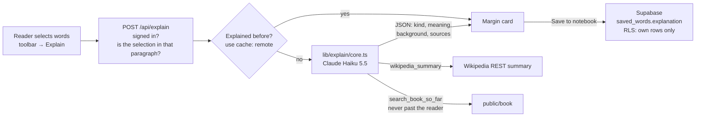
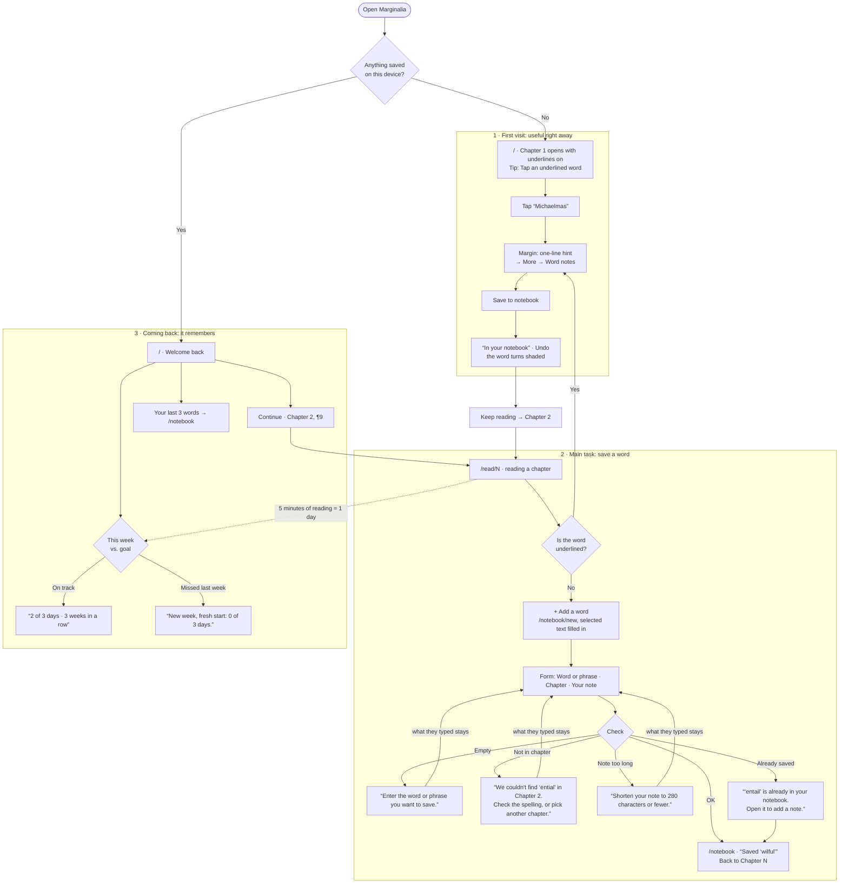

# Marginalia

**Read *Pride and Prejudice* with a guide in the margin.** Select any word or line you don't
understand and choose **Explain**: the margin says what it means in that sentence, as Austen
used it, with where that came from, and never gives away what happens next. Save it to a
notebook that follows you to any device. Underlined words have hand-written notes too.

- **Live:** https://marginalia-fullstack-eight.vercel.app
- **Code:** https://github.com/Rogernarten/Marginalia-fullstack

Design, Build, Ship · **Project v1** (focus: AI), built on Assignment 4.
The proposal set the core task:

> A new reader signs up, opens *Pride and Prejudice*, selects a word or line they don't
> understand, reads an explanation that fits that sentence without leaving the page, and saves
> it to their notebook.

## Project v1: Explain in the margin

### The core task, start to finish

1. **Select** a word or a line in the text. A small toolbar appears next to it: **Explain**,
   **Look it up**, **Save**.
2. **Explain**. Signed out, the margin offers **Create an account** and brings you back to the
   same paragraph with the words explained. Signed in, it answers in a few seconds.
3. **Read** it in the margin (a bottom sheet on phones): one line of meaning, up to two
   sentences of background, and its sources: the sentence itself, a Wikipedia article, or an
   earlier passage of the book, linked. Every answer says it was written by AI and can be wrong.
4. **Save to notebook**. The word stays shaded in the text, and the notebook keeps the
   explanation, so it never calls the model again.

### How it works



| | |
|---|---|
| **Model** | Claude Haiku 5.5, at low effort, called only from the server ([`lib/explain/server.ts`](lib/explain/server.ts)). Chosen by the evals below: the cheapest model, and good enough on them (85% pass, every spoiler trap clean). On the first three test passages Sonnet 5.5 was no better and cost about 20 times as much ($0.030 against $0.0016). |
| **What it gets** | The selection, its sentence, its paragraph and the two before it. Nothing after the reader's paragraph. |
| **Tools** | `wikipedia_summary` for customs, things, places and people (entail → "Fee tail"). `search_book_so_far` for names and earlier uses of a word, from Chapter 1 to the paragraph before the reader's, never ahead. A "context" note answered without Wikipedia is sent back once to look it up. At most 4 model calls per explanation. |
| **No spoilers** | By construction: the model never sees later text, and is told not to use what it remembers of the novel. Checked by six spoiler traps in the evals. |
| **Sources can't be made up** | The model answers in a fixed JSON shape and cites ids the tools returned ("wikipedia:Fee tail", "book:1:10"). Any other id is dropped before the reader sees it; the evals count them (3 in 67 answers). |
| **It explains, it doesn't read for you** | Kim's worry in the proposal ("I just ask AI, I can't be bothered to think"): it explains only the selection, briefly, and never summarizes the chapter or retells the plot. It isn't a chatbot: the server rebuilds the passage from the book, so only text that's really in that paragraph can be asked about. |
| **Cost** | About $0.0004 per new explanation. Each passage is kept in Vercel's remote cache, so the same selection in the same paragraph calls the model once. Signed-in readers only. |

### Evals

[`evals/run.mjs`](evals/run.mjs) runs the same code the app runs on 67 cases: every hand-written
hint for Chapters 1 to 3 (61), with the hint as the answer key, and six names that tempt a
spoiler (Wickham in Chapter 15, Charlotte in Chapter 5, Mr. Darcy in Chapter 3, and others,
[`evals/spoiler-cases.json`](evals/spoiler-cases.json)). Each property is graded on its own:

| Check | How |
|---|---|
| **Correct** | A judge model: same sense as the hand-written hint, for this sentence |
| **No spoiler** | The judge: nothing the reader only learns after this paragraph |
| **Short** | Code: meaning ≤ 25 words, background ≤ 2 sentences |
| **Outside source** | Code: "context" notes cite Wikipedia or an earlier passage |
| **Made-up sources** | Code: cited ids no tool returned |

The judge is DeepSeek V4 Pro: a different model family from the one it grades, and about $0.0015
a case (Opus 5.5 was about $0.01). Checked before trusting it: the hand-written hints pass 58 of
59, a useless fixed answer ("A word or phrase used in the novel.") passes 0 of 10, and on 46
hints graded by both, it agrees with Opus 5.5 on "correct" 45 times and on "spoiler" 41. API
errors are kept apart from wrong answers, and every case's full trace is saved in
[`evals/runs/`](evals/runs/).

**Claude Haiku 5.5, the model that ships** ([run](evals/runs/20261117-1806-claude-haiku-5-5-rescored.json)):

| | |
|---|---|
| Pass (correct, short and spoiler-free) | **57 / 67** (85%) |
| Correct | 53 / 61, and 6 / 6 on the spoiler traps |
| Short | 67 / 67 |
| No spoiler | 59 / 61, and **6 / 6 spoiler traps clean** |
| Context notes with an outside source | 14 / 25 |
| Made-up source ids, dropped | 3 |
| Cost per explanation · latency | $0.00044 · median 1.9 s, 90% under 5.2 s |

**What's still wrong:** four factual slips in the background (a chaise "normally drawn by one
horse"; who calls first on a newcomer, reversed; the modern sense of *circumspection*; the
Boulanger as the wrong kind of dance), four that miss the point of the hint (that "from the north
of England" means new money from trade), and one real spoiler (naming Elizabeth as the slighted
daughter before the book does). The tenth failure is the judge's mistake: it flagged a detail
from the same paragraph.

### What the evals changed

| Found | Changed |
|---|---|
| The first run (24 cases): 4 too long, with backgrounds of three or four sentences | The prompt asks for 20 words and two sentences, 40 words in all: 61 / 61 short |
| It almost never looked anything up: 1 of 10 context notes had an outside source | Context notes must call Wikipedia first, and are sent back once if they don't: 14 / 25 |
| It explained only the easy word in a phrase ("fortune" in "a young man of large fortune from the north of England") | "Explain the part a modern reader would miss" |
| My grader counted "Mrs." as the end of a sentence and failed 27 answers as too long | Fixed, and `--rescore` re-grades saved answers without calling any model |
| The two judges, run on the hand-written hints themselves, flagged spoilers in 14 of them between them (Lydia's bonnet in Chapter 39, Pemberley in Chapter 43, where Elizabeth first sees Darcy) | All 14 rewritten with only what the reader knows so far. Re-judged: 14 / 14 correct and spoiler-free |
| The book search cut sentences at "Mrs." and returned the reader's own paragraph | Real sentence ends; it starts from the paragraph before |

### Testing the core task

- [`e2e/explain.spec.ts`](e2e/explain.spec.ts): a reader opens Chapter 7, selects *entailed*,
  explains it (with a Wikipedia source), saves it, and finds it in a freshly loaded notebook,
  marked Explained. Signed out, `/api/explain` answers 401. It passes locally and against the
  live site, and the Assignment 4 privacy test still passes with the new column.
- **A new reader on the live site.** I signed up as someone new and did the core task. It worked
  end to end, and four places were confusing:

| Got stuck | Changed |
|---|---|
| The home page only said "Tap an underlined word"; nothing said any other words could be explained | "Stuck on anything else? Select a word or a line and choose **Explain**" |
| Signed out, Explain offered only "Sign in", to someone with no account | **Create an account** first, with "you'll come back right here, with '…' explained" |
| After signing up: back at the top of the page, selection gone, card closed | Back at the same paragraph (`#p-N`) with the card open and the words explained |
| Explain and Look it up were buttons above the text: select first, then go back up to press one | A toolbar right at the selection: above it, or below it on phones, where the phone's own menu sits above |

### Testing with readers

Kim, Tom and Mike, the three readers from the proposal, try v1 on 17 November with one task:
find a word or a line you don't understand, have it explained, and save it. What each of them
did and said, and the plan for v2 that starts from it, follow here.

### Before shipping

- **Keys:** `ANTHROPIC_API_KEY` in `.env.local` and Vercel's environment variables, never in
  the repository (checked: no key in the git history, no `.env` file tracked).
  [`.claude/settings.json`](.claude/settings.json) keeps agents out of `.env` files. The
  DeepSeek key is used only by the evals, run on my machine; it isn't on Vercel.
- **Row-level security:** the new `saved_words.explanation` column
  ([migration](supabase/migrations/20261117190000_add_explanation_to_saved_words.sql)) is covered
  by the existing own-rows-only policies; the privacy test passes.
- **`/security-review`:** no high or medium findings. Next.js went from 16.4.2 to 16.4.6 for two
  cache-leak advisories (GHSA-mfr8-8qww-v76h, GHSA-vc7v-qv4w-wrv8).
- **Limits:** a monthly spending limit on the Claude account (Console → Limits); DeepSeek is prepaid.

### Run it

```bash
npm install
# .env.local (create it yourself; the agent can't read it):
#   NEXT_PUBLIC_CLERK_PUBLISHABLE_KEY, CLERK_SECRET_KEY
#   NEXT_PUBLIC_SUPABASE_URL, NEXT_PUBLIC_SUPABASE_PUBLISHABLE_KEY
#   ANTHROPIC_API_KEY                          (Explain)
#   DEEPSEEK_API_KEY                           (the eval judge only)
#   E2E_READER_A_EMAIL, E2E_READER_B_EMAIL     (two +clerk_test accounts, for the tests)
npm run dev
npm run explain -- 7 "entailed"              # one explanation in the terminal
npm run eval                                 # all 67 cases, about $0.18
npm run eval -- --oracle                     # check the judge on the hand-written hints
npm run test:e2e
```

### How I worked with the agent

Built by directing Claude Code in steps, with a check after each; the commit history follows
them. **Decisions I made:**

- The core task, and the riskiest part first: the explain call and its eval before any screen.
- Haiku 5.5 over Sonnet 5.5, once the evals showed it passed.
- DeepSeek V4 Pro as the judge, when Opus 5.5 judging became the main cost.
- Context notes must look things up, so they have a source a reader can check.
- Rewrite the 14 hand-written hints the judge caught with spoilers, rather than leave them.
- The selection toolbar: after using it, the buttons above the text felt confusing, so Explain,
  Look it up and Save moved to where the words are selected.

### Next

The plan for v2 comes after the readers' sessions. One direction already chosen: **a bookshelf,
starting with Hegel's *Phenomenology of Spirit***, in J. B. Baillie's 1910 translation, *The
Phenomenology of Mind* (public domain in the US; the modern translations aren't). Philosophy
changes what Explain should do: a term as *this* author uses it, where in the book he defined it,
and what this sentence does in the argument, without jumping ahead to its conclusion (the
spoiler rule, for an argument). It needs its own eval, with references checked by hand.

---

## Assignment 4: accounts, data and Wikipedia

_What Assignment 4 added, unchanged since. Project v1, above, builds on it._

| | |
|---|---|
| **Accounts** | Clerk: sign up, sign in, sign out. The book and the hand-written hints stay public; the notebook (`/notebook`, `/notebook/new`) and Wikipedia lookups need sign-in, checked on the server with `auth.protect()` in each page and `auth()` in the API route. |
| **Data** | Supabase: `saved_words`, `reader_state`, `reading_days` ([migration](supabase/migrations/20261027185911_create_marginalia_tables.sql)). Every row has a `user_id`, filled in by the database from the Clerk token's `sub`. Row-level security on every table: four policies each, all `(select auth.jwt() ->> 'sub') = user_id`. Signed-in readers get only select, insert, update and delete ([second migration](supabase/migrations/20261027193545_limit_reader_table_privileges.sql): Supabase's defaults also allow `truncate`, which skips RLS); signed out gets nothing. |
| **API** | Wikipedia's REST summary, for things, customs and places (curricle, entail, Pemberley). Select a word, choose **Look it up**. Designed states: loading, found, found under another name, several meanings, nothing found, Wikipedia down, signed out. |
| **Where the API is called** | On our server, `GET /api/lookup` → [`lib/wikipedia.ts`](lib/wikipedia.ts): signed-in only so it isn't an open proxy, it sends the `User-Agent` Wikimedia asks for (browsers can't), and each title is cached for a day for every reader. |
| **Keys** | In `.env.local` and Vercel's environment variables only. [`.claude/settings.json`](.claude/settings.json) denies the agent `Read` and `Edit` on `.env` files. The browser gets only publishable keys; the Supabase secret key isn't used at all. |
| **Test** | [`e2e/notebook-privacy.spec.ts`](e2e/notebook-privacy.spec.ts): two readers each save a word; each notebook, loaded fresh, shows only its own. Watched it catch a broken policy: with the select policy changed to `using (true)` in the SQL Editor, it fails on "Reader A must not see reader B's word"; with the policy restored, it passes. |

### One save, traced (Assignment 4)

Reader taps **Save to notebook** → `lib/storage.ts` shows it at once, then asks Clerk (in the
browser) for the session token → sends the row straight to Supabase with that token → Supabase
checks the token against Clerk (third-party auth), fills `user_id` from its `sub`, and the insert
policy checks it matches → 201. A Wikipedia-saved word carries a copy of the summary, so the
notebook never calls Wikipedia again.

---

_Below: the Assignment 3 write-up. Where it says everything stays in the browser, that was
true then; Assignment 4 moved saved data to Supabase._

## Who it's for

Someone who wants to read the classics in English but keeps tripping over two kinds of things:
words that have changed meaning (*want*, *design*, *tolerable*) and customs nobody explains any
more (why Mr. Bennet has to visit first, what “four or five thousand a year” means). Ordinary
reading apps give a dictionary definition or a straight translation. This gives a short hint
first and more on request, written for a reader of 1813, and never just translates.

The first idea was an app that explains any passage with AI on demand. This week's brief allows no
external APIs, so the hints are written ahead of time and shipped as data: 61 hand-checked notes
on Chapters 1 to 3. The whole book (all 61 chapters) can be read, and any word in any chapter can
be saved with your own note.

## The main flow

> I tap a word I don't know → I see what it meant in 1813 and save it to my notebook →
> I come back on Sunday, see my week, and pick up where I stopped.



The same diagram, with the states table, lives in [`flows.md`](flows.md).

### Pages

Each step of the flow is its own route, with the same navigation on every page (Read, Notebook
with a word count, and the title back to the start).

| Route | Step |
|---|---|
| `/` | **First visit:** Chapter 1, with notes ready. **Coming back:** Welcome back (decided once, on load) |
| `/read` | Contents, with Continue and “You're here” |
| `/read/[chapter]` | Reading, with the margin; offers to jump back to where you stopped |
| `/notebook/new` | The form: save a word |
| `/notebook` | Your words, by chapter |

## First visit

**What someone new sees:** a one-line promise (“Read it with a guide in the margin”), then
Chapter 1 itself, with words already underlined. One tap on *Michaelmas* shows a hint in the
margin (a bottom sheet on phones), and one more saves it. There's no sign-up, no tour and no empty
screen: the book is the onboarding.

**Research.** Subagents studied how three reading tools welcome someone new:

| Tool | First screen | What we took or avoided |
|---|---|---|
| Kindle | Sign in, then an empty library; Word Wise has to be switched on | Avoid the empty start. Its auto-picked hints define easy words and miss period ones, so our hard words are chosen by hand |
| LingQ | Sign-up and 4–5 setup screens before reading | Avoid the wall. Copy: color words by state (new, saved) and save the sentence with each word |
| 微信读书 (WeChat Read) | Books chosen for you; a shared link opens straight into the text | Copy: open on the text itself, one tap menu, notes that jump back to the passage. Avoid strict streaks and pop-ups during reading |

All three pointed the same way: open on Chapter 1 with notes already on, ask for nothing first,
and keep goals forgiving.

## The form

`/notebook/new` saves any word, even in chapters with no notes. One column: **Word or phrase**,
**Chapter**, and **Your note (optional)**. Select a word in the text before pressing **+ Add a
word** and it's filled in. The word is checked against the chapter's real text, so the notebook
only holds words that are actually there, spelled the way the book spells them (typing
*tomorrow* saves *To-morrow*), with the sentence attached automatically.

Errors sit under their field, say what to do next, and keep what you typed:

| When | The message |
|---|---|
| Nothing typed | Enter the word or phrase you want to save. |
| Not in that chapter | We couldn't find “ential” in Chapter 2. Check the spelling, or pick another chapter. |
| Already saved | “entail” is already in your notebook. Open it to add a note. (with a link) |
| Note too long | Shorten your note to 280 characters or fewer (now 312). |

Focus moves to the first field with an error; after the first try, fields re-check when you
leave them. An unfinished form is kept as a draft (“We kept what you typed last time.”).

## Coming back

**What brings someone back:** the book itself (picking up mid-chapter) and a weekly reading goal
that's hard to fail. A day counts after five minutes of real reading (the tab visible, and you
scrolled, tapped or pressed a key in the last 90 seconds). The goal is days per week (3 by
default, 1 to 7), and the streak counts **weeks** in a row, so missing a day never breaks it.

**Welcome back** shows, in this order: where you stopped (chapter, paragraph and its first words,
with Continue), this week as seven days with check marks, and your latest words. If last week fell
short, it says “New week, fresh start: 0 of 3 days.” and nothing more: no guilt, no pop-ups. Your
saved words stay shaded in the text when you read again, and opening one shows your note.

**What it remembers** (one localStorage key, `marginalia:v1`):

| Saved | Used for |
|---|---|
| Words: the word, chapter, paragraph, sentence, your note, the hint it came from | Notebook, shading in the text, latest words |
| Position: chapter and paragraph | Continue, “You stopped at paragraph 15”, “You're here” |
| Seconds read per day | This week, streaks |
| Weekly goal | This week |
| Form draft | Keeping what you typed |

If the browser won't save (private mode, a full disk), a banner says so instead of silently
losing words.

## Accessibility

Everything works with a keyboard, every field has a real label, and every color pair was checked
for contrast. Full details, the contrast table and the keyboard map:
[`docs/accessibility.md`](docs/accessibility.md).

- axe-core (WCAG 2.2 AA) on 11 pages and states: 0 violations
- Every Tab stop on six pages is visible with a focus ring; a whole visit works without a mouse
- No sideways scrolling at 320px
- Text contrast from 5.7:1 to 15.2:1; underlines, borders and focus rings at least 3.6:1

## First-run check

Once the site was live, a fresh agent with no access to the code or this conversation got the URL
and a goal: *“I'm reading Pride and Prejudice in English for a class and keep tripping over
old-fashioned words. Save three words I didn't know from Chapter 1, with a note on at least one.”*
It used the site in Chrome at 1440px and 390px and with the keyboard alone, then shifted its saved
dates back eight days and came back “a week later”.

**First impression, in its words:** “It was clear right away… an annotated Pride and Prejudice
where I tap underlined words. The text of Chapter 1 is on the home page, so I knew what to do at
once.”

**What worked for it:** the hint card with More, saving in one click, the count in the navigation,
saved words shaded in the text, a selected word carried into the form, specific error messages,
and “Open in Chapter 1” landing on the right paragraph. Keyboard use was “very good”. Coming back,
it was greeted with “Welcome back. New week, fresh start: 0 of 3 days.”, and Continue took it to
the exact paragraph: “Picking up was obvious.”

**What it found, and what I changed:**

| Found | Changed |
|---|---|
| After fixing a misspelling, the first click on Save did nothing: the error cleared on blur, Save jumped up about 48px, and the click missed. The old error also stayed up while typing | Errors re-check while you type (after a short pause), never on blur and never mid-click. One click saves |
| In the margin, “Undo” sat next to “Edit note” and deleted the word and its note; Remove had no undo | After saving: Add a note and Remove. Remove leaves an Undo that brings the word back with its note |
| The word whose note was open turned the same yellow as saved words, so unsaved words looked saved | The open word gets an ink ring. Yellow means saved and nothing else; hover is a pale tan |
| The sentence saved with *caprice* ran on into the next one | Sentences that start with an italic word (*Her*) now split correctly |
| After a second save, the notebook didn't scroll to the new word | It scrolls to and highlights every newly saved word |
| “Open it to add a note” even when the word already had a note | It says “Open it to see your note” then |
| With More open, the margin ran past the bottom of the screen and hid Save note | The margin fits the screen and scrolls inside |

**Heard, and kept for the next version.** I fixed every bug first; these are the bigger changes
it suggested:

- Saving a word that isn't underlined is slow: select it, scroll back to **+ Add a word** at the
  top, then land in the notebook. Its top request was a Save button right at the selection.
- When a word isn't in the chosen chapter, search the whole book (“It's in Chapter 1”).
- On a phone, the sheet can cover the word you tapped, and the phone legend leaves out the
  + Add a word hint.
- Welcome back doesn't say when you last read, and Tab reaches the weekly goal before your latest
  words.
- The weekly goal is the only nudge to return; it wanted review and export of saved words. When
  planning I chose picking up the book and a reading goal over flashcards, so review is the next
  feature I'd add.

## How I worked with the agent

Everything was built by directing Claude Code, in steps with a checkpoint after each one, and the
commit history follows those steps.

**Decisions I made:**

- The idea, and adapting it when the brief ruled out APIs: hints written ahead of time instead of
  on demand.
- *Pride and Prejudice* in English (over Homer): it's English in the original, so the language
  notes teach real English.
- Which tools to research, including 微信读书.
- What brings people back: picking up where you stopped and a weekly goal with streaks, not
  flashcard review.
- Reopening a chapter offers a jump (“You stopped at paragraph 15 · Jump there”) instead of
  scrolling by itself; Continue goes straight there.
- After using it, I asked why my own notes didn't show in the text the way the hints do. The agent
  had left self-saved words as plain shading; now they open like hints, with the note editable in
  place.

**What testing caught.** The agent drove headless Chrome to test each step at 390px and 1440px,
with a keyboard, and with axe-core. That found: focus lost when Save turned into Undo; Esc in the
note editor closing the whole note; Next.js keeping hidden copies of pages in the DOM, so a jump
could land in the wrong copy of a paragraph; a React key warning when entering a chapter from
outside the Contents; the home page, nav and chapter links overflowing small phones; and seven
paragraphs split mid-sentence by illustrations in the Gutenberg text.

## Stack and code

Next.js 16 (App Router, every page static) and Tailwind CSS 4 on Vercel's Hobby plan. No database,
accounts, backend or external APIs; the only package added is `@tailwindcss/postcss`.

- `app/`: one folder per route.
- `components/ui/`: shared buttons, fields (label, hint, error), toast, notices and navigation,
  used on every page.
- `components/reader/`: the reader, the margin cards, reading position and timer.
- `components/notebook/`: the form, the notebook and the note editor.
- `lib/storage.ts`: everything saved, behind one localStorage key. `lib/week.ts`: weeks, goals
  and streaks. `lib/text.ts`: finding words in the text.
- `lib/notes/`: the hints for Chapters 1 to 3.
- `public/book/`: the text, one JSON file per chapter, built by `scripts/build-book.mjs` from
  [Project Gutenberg #1342](https://www.gutenberg.org/ebooks/1342) (public domain).

```bash
npm install
npm run dev   # http://localhost:3000
```
